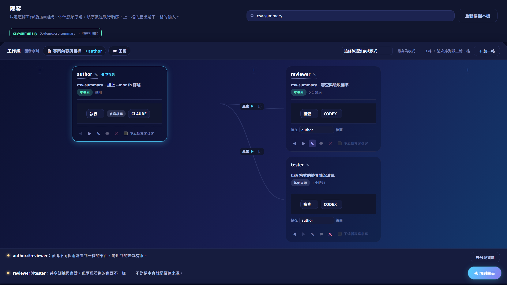
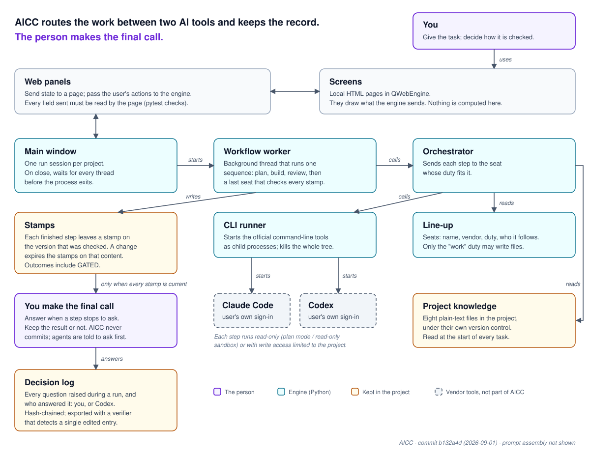
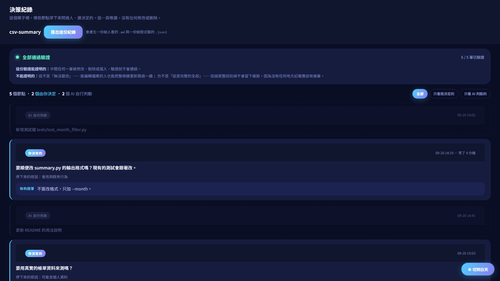
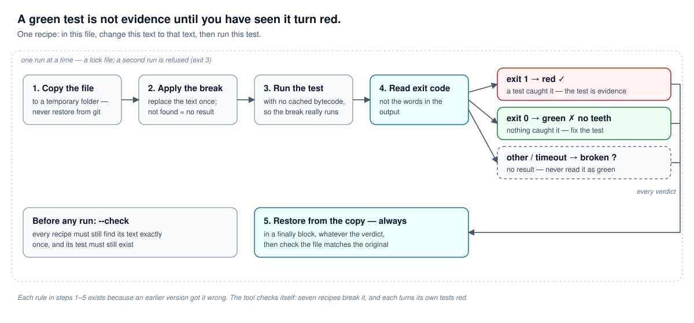

# AI Control Center (AICC)

A Windows desktop app that runs **Claude Code** and **Codex** as a team on one project — one writes, another reviews — and stops for a person only when a real decision is needed.

AICC does not call model APIs and never handles your credentials. It drives the official command-line tools with the sign-in you already have.



*All screenshots on this page use demo data.*

> **Status: being refined.** It runs, it is covered by 2,219 tests, and it has not yet completed a full run end to end. Read [Limitations](#limitations) before you try it.

---

## Why it exists

Two AI agents on one project — one to write, one to check — and the person ends up carrying everything between them: copying output, deciding who goes next, remembering what was agreed three days ago. Checks get skipped because nothing records whether they ran.

AICC takes over that routing and keeps a record of who approved which version.

---

## How it keeps unreliable output in check

An LLM can answer the same prompt two different ways, and it does not raise its hand when it is wrong. AICC adds a safeguard at each of five layers.

| Layer | What AICC does |
|---|---|
| **Prompt** | Each duty (plan, work, review, approve) has its own instructions and output format. Limits are written into every task: change only the files needed, no commits, no installs. When a step meets something it should not decide, it must stop and ask in a format the engine parses. |
| **Context** | Project memory is plain-text files in the project. The security rules and the list of questions the agents may not decide are sent word for word with every task; the rest are chosen by duty. A full-text index with Chinese word segmentation picks the relevant passages and records why. Memory is never truncated — if a security rule would arrive cut off, the run stops. |
| **Harness** | The official CLIs run as child processes under your own sign-in. Permissions are set per step: review steps are read-only (Claude plan mode, Codex read-only sandbox); the writing step can write only inside the project. Force-pushing, dropping a table or carrying a secret stops the run for a person even if the reviewing agent said continue. |
| **Loop** | Build, run the project's declared test command, fix automatically if it fails (up to two attempts), then review. When the attempts run out the run stops for a person instead of passing. Approval has no "after N rounds it counts as agreed" rule. |
| **Graph** | The line-up is a node graph: each seat has a name, a vendor, a duty and the seat it follows, and it can branch. The seat that does not do the work writes "what counts as done" before anything is built. The last seat reads every stamp; a run is complete only when every stamp sits on the current version. |



---

## Evidence, not "the agent said so"

Each finished step leaves a **stamp** on the version it checked.

- A **machine stamp** cannot be created without evidence: the command, its output, and how it was judged.
- A **review stamp** must say why the reviewer agrees, and cannot carry a pass/fail result — agreeing is not a measurement.
- **GATED** is its own outcome for work with no test to run. Not a pass, not a failure: a person looks.
- Change the content and the stamps on it expire. Only the stamps that depend on that content expire.

Every question a run stopped to ask is appended to a hash-chained decision log, together with who answered it — you, or the AI. The log exports with a standalone verifier that detects an edited or removed entry. It does not prove the log is honest: anyone who can edit the file can recompute the whole chain, and the verifier says so itself.



---

## Requirements

- Windows 10/11
- Python 3.14
- [Claude Code](https://claude.com/claude-code) CLI, signed in
- Codex CLI, signed in
- Your own subscriptions for both. AICC never asks for an API key, and no function in it can accept one.

## Install and run

```powershell
git clone <this repository>
cd ai-control-center
py -3.14 -m venv .venv
.\.venv\Scripts\python.exe -m pip install -r requirements.txt
.\.venv\Scripts\python.exe -m app.main
```

`start.bat` does the last step for you.

**The interface is in Traditional Chinese.** The translation layer is not built yet.

## Verify it yourself

```powershell
.\.venv\Scripts\python.exe -m pytest tests/ -q          # 2,219 tests, 0 skipped, exit code 0
.\.venv\Scripts\python.exe tools\negative_control.py --all   # 111 recipes
.\.venv\Scripts\python.exe tools\verify_web_pages.py    # every page in a real browser engine
```

Measured 2026-09-23 on a clean clone of this repository, with the virtual environment created as above.

**Negative control** is the check this project cares most about: it breaks one line of the product on purpose, runs the test that should catch it, requires the test to turn red, then restores the file from a copy and checks the restore. A green test is not evidence until you have seen it red.



---

## Limitations

Measured 2026-09-22.

1. **Windows only.**
2. **You need both CLIs installed and signed in.** AICC drives them; it does not replace them.
3. **The interface is Traditional Chinese only.**
4. **No full run has completed end to end yet.** 7 recorded runs, none finished.
5. **When an agent hits its usage limit, the run stops and waits for you.** It does not resume by itself.
6. **Duties are fixed** — plan, work, review, approve. You cannot define your own yet.
7. **The installer is older than the code.** Last packaged 2026-08-08; run from source for now.
8. **Local only.** No cloud sync, no multi-machine setup.
9. **Agent safety rules are enforced through instructions and each tool's permission mode**, not by blocking individual commands.
10. **The decision log detects an edited entry, not a rewritten chain.**

---

## Repository layout

```
app/            the engine: core logic, services, UI panels, built web pages
design-pages/   the HTML the app renders; app/ui/web is built from here
tests/          2,219 tests
tools/          negative control, page verification, indexing, memory budget
docs/           design notes and the decision history (Traditional Chinese)
packaging/      Inno Setup installer script
```

`app/ui/web/` is generated. Change `design-pages/` and rebuild:

```powershell
.\.venv\Scripts\python.exe app\ui\web\build_pages.py
```

Each page's `<style>` block is hashed before and after the copy, so a CSS change cannot slip in by accident.

## Documentation

- [`docs/WHY.md`](docs/WHY.md) — every product rule, the wording that decided it, and what it replaced (Traditional Chinese).
- [`docs/規則分三層.md`](docs/規則分三層.md) — how rules reach the agents.
- [`docs/模組劃分計畫.md`](docs/模組劃分計畫.md) — how the engine is split into modules.
- [`docs/五節點測試.md`](docs/五節點測試.md) — the five-node run this project is built around.
- [`README.zh-TW.md`](README.zh-TW.md) — the original Chinese readme.

## Contributing, security, licence

- [CONTRIBUTING.md](CONTRIBUTING.md) — how to set up, and the two rules every change must follow.
- [SECURITY.md](SECURITY.md) — how to report a vulnerability.
- [LICENSE](LICENSE) — MIT.
