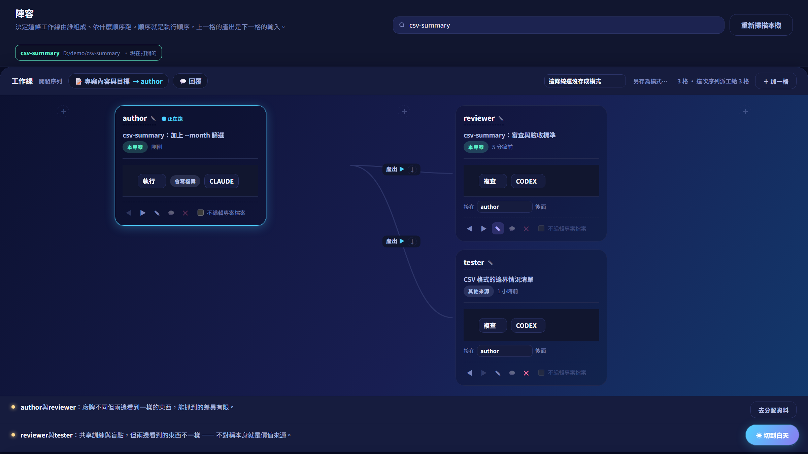

# AI Control Center（AICC）

**把 Claude Code 與 Codex 的分工、專案背景、驗證與人工決策，放進同一個 Windows 桌面工作流程。**

[English](README.md) · [架構與設計分工](docs/ARCHITECTURE.md) · [文件導覽](docs/README.md) · [安全邊界與已知問題](SECURITY.md)

> **作品快照，暫無固定維護計畫。** 我已在完成前置設定的個人環境中成功跑過完整流程；私人專案、對話與產出不放進公開 repository。這是一個有實際功能、也有已知缺陷的原型。目前請從原始碼執行，安裝版仍有問題。



## 為什麼做

同時使用兩個 AI 寫程式，人很容易變成中間的傳話者：把需求複製給另一邊、重講背景、轉交審查意見，最後還要記住「這個結果到底有沒有測過、核准的是哪一版」。

AICC 把這些交接變成明確流程。它整合既有對話、專案文件、共同記憶、角色分工與執行紀錄，目的是減少人工搬運資訊，並讓需要人判斷的地方看得見。它呼叫官方 CLI，沿用使用者自己的登入；送給 CLI 的內容仍可能交由廠商雲端處理，「本機優先」不代表所有資料都留在電腦上。

## 我負責什麼

這是我獨立規劃、使用 AI 協作完成的作品。產品方向、整體架構、流程規則、模組邊界與功能取捨由我決定；實作、除錯、測試方式與架構驗證，透過我與 AI 反覆討論、執行和檢查形成。

我把 Prompt、Context、Harness、Loop 與 Graph Engineering 的概念用在這個系統中。這裡展示的是我如何運用這些概念做設計，不是宣稱發明了這些概念，也不是宣稱每一行程式都手寫或已通過第三方安全認證。

## 可以看見的設計判斷

| 問題 | 我的處理方式與取捨 |
|---|---|
| 每個角色都收到過量或不相關資訊 | 依職責組裝提示詞、分層規則與檢索內容；必要安全規則不應被默默截斷。 |
| AI 說完成，不等於真的通過驗證 | 區分機器執行證據、審查理由與人工核准，並把章綁定內容版本。 |
| 一直自動修，卻不知道何時交還給人 | 修正迴圈最多兩次；無法完成時停下來交由人判斷。 |
| 角色圖容易被誤認為完整流程引擎 | 畫面上的 `parent` 連線描述結構；實際執行由座位順序與職責規則控制，沒有宣稱任意 DAG 排程。 |
| 流程邏輯與外部工具變動混在一起 | 分開核心步驟、CLI adapter、資料服務與介面。部分大型檔案仍有耦合，並非已完成所有重構。 |

## 目前能做什麼

- 掃描、配對 Claude／Codex 本機對話，連結到專案與角色陣容。
- 協調規劃、執行、專案宣告的驗證、複查、核准與待決問題。
- 索引專案文件、管理文字型共同記憶，查看多專案狀態與執行紀錄。
- 提供選用的 LINE 通知及透過 Google Drive 客戶端資料夾進行同步；兩者都有資料流與安全限制。

## 從原始碼啟動

需要 Windows 10/11、Python 3.14、已安裝並登入的 Claude Code 與 Codex CLI。工作流程若使用 Git，需另外安裝 Git；兩個廠商帳號須能使用選定模型，且有可用額度。介面目前為繁體中文。

下載或 clone 後，在專案根目錄開 PowerShell：

```powershell
py -3.14 -m venv .venv
.\.venv\Scripts\python.exe -m pip install -r requirements.txt
.\.venv\Scripts\python.exe -m app.main
```

環境建立後也可使用 `start.bat`。執行原始碼不需要先製作安裝程式，網頁面板已包含在 repository。

第一次試用請用不含敏感資料的可丟棄專案，配對對話、選好角色，並宣告該專案的驗證指令。沒有可執行的驗證，不能當成機器驗收通過。我的私人共同記憶不是安裝必要檔案；你使用的專案要提供自己的背景。LINE／Drive 都不是基本啟動的必要設定，可先停用。

我已成功跑過設定完成後的流程，但這不代表每台電腦、每個 CLI 版本或每種任務都已驗證。

## 驗證到哪裡

以下為程式快照 `15c1324` 的審查結果，與個人成功使用經驗分開記錄：

- **原測試：** 2,219 個案例納入分檔執行；最新合計 2,200 通過、19 失敗、0 跳過。其中 18 條受環境或測試資料限制，另有較小範圍補證據；不能算原測試全過。1 條守衛邊界仍失敗，單行程整套執行曾發生 Qt 崩潰。
- **破壞測試：** 111 份配方、853 條項目全跑；846 變紅、7 仍綠、0 執行損壞。其中 25 條原始測試已失敗，不算有效攔截。
- **介面：** 來源版兩種視窗尺寸皆 10/10；打包版 8/10，缺少 `shell.js` 導致側欄與頂欄失敗（打包設定之後已補上，打包版尚未重建重驗）。
- **打包：** PyInstaller／Inno 編譯成功，不代表完整安裝、升級、取消已通過。

審查之後修了四個問題：匯入與同步的路徑出界、安裝程式的資料夾所有權、打包漏掉 `shell.js`。每一個都有新的測試與破壞測試配方，在作者的環境跑過；審查者沒有重跑。細節見 [CHANGELOG.md](CHANGELOG.md)。

開發檢查指令見 [英文首頁](README.md) 與 [CONTRIBUTING.md](CONTRIBUTING.md)。測試及破壞測試請使用可丟棄 checkout 與隔離 Windows 帳號／VM；破壞測試會暫時改動程式後還原。一般閱讀、啟動作品不需要先跑完所有測試。

## 限制與維護

匯入／同步路徑出界、安裝器資料夾所有權、打包漏檔已在審查後修正。仍未修：刪除守衛的所有權、敏感內容進入審查提示詞、壓縮檔資源上限，以及 [SECURITY.md](SECURITY.md) 列的其他項目。揭露不等於修復，不適合直接套用在重要或敏感專案。

刪除保護目前只擋幾個重要位置（例如 Windows 使用者設定資料夾），還不是「只能動專案資料夾、其他地方要使用者按確認」。

LINE 通知的「忘記憑證」按鈕目前按了沒有作用；要清掉 LINE 設定，請手動刪除 `%APPDATA%\AIControlCenter` 裡的 LINE 設定檔。

廠商 CLI 權限與額度會影響執行，AICC 本身不是作業系統沙箱；角色職責固定、尚無多語介面，額度耗盡需人介入。決策紀錄的雜湊鏈不能保證沒有尾端刪除、沒有重寫，也不能證明內容真實。

暫無固定更新或回覆承諾。原始碼以 [MIT](LICENSE) 開放，適合閱讀、試用非敏感範例與自行修改。請從 [架構說明](docs/ARCHITECTURE.md) 看模組分工，從 [文件導覽](docs/README.md) 區分現況與歷史；歷史 roadmap 不是交付承諾。
